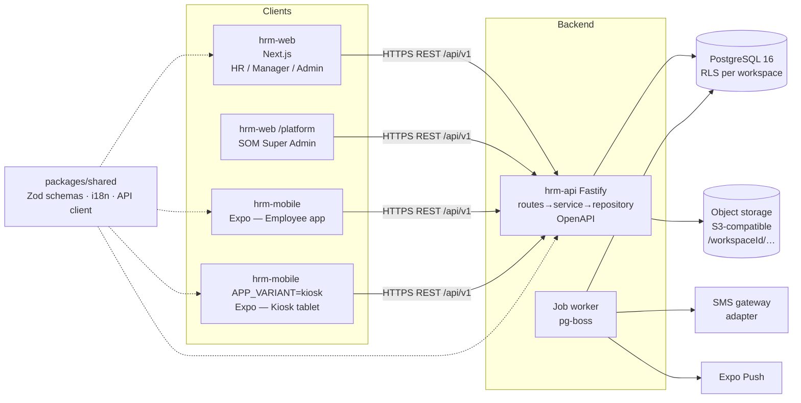
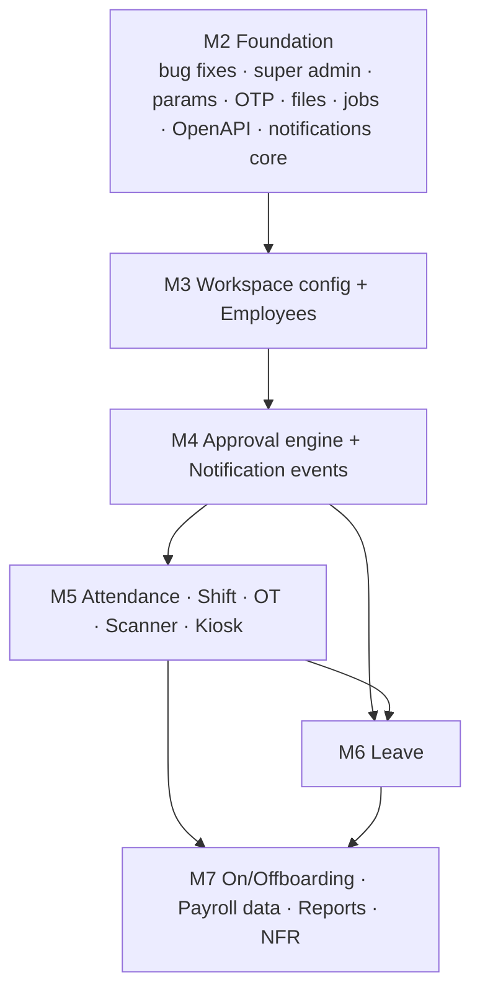

# SOM HRM — Technical Analysis & ສະຖາປັດຕະຍະກຳທີ່ສະເໜີ (Phase 1)

ວັນທີ: 2026-11-16 · ອ້າງອີງ commit `b778f88` (M1) · ແຫຼ່ງຂໍ້ມູນ: TOR v1.0 (draft, 11/11/2026, 22 ໜ້າ), PRD (ພາສາໄທ),
ການກວດ code ທັງ repo. ເອກະສານຄູ່ກັນ: [REQUIREMENT_TRACKING.md](REQUIREMENT_TRACKING.md) (308 ແຖວ, ທຸກ FR ID) ·
[IMPLEMENTATION_PLAN.md](IMPLEMENTATION_PLAN.md) (milestones).

> **ສະຖານະ: ລໍຖ້າອະນຸມັດ.** ຕາມ Master Prompt §12 ຈະບໍ່ປ່ຽນໂຄງສ້າງໃຫຍ່ (ສ່ວນ §5 ແລະ §6) ຈົນກວ່າຈະໄດ້ຮັບການອະນຸມັດ.

---

## 1. ສະຫຼຸບຫຍໍ້

- Repo ເປັນ **monorepo ຢູ່ແລ້ວ** (pnpm workspace) ແລະ stack ເໝາະສົມກັບ TOR (NFR-10: ເຕັກໂນໂລຢີທີ່ນິຍົມ ຫາຄົນງ່າຍ).
  **ບໍ່ມີເຫດຜົນທາງເຕັກນິກທີ່ຕ້ອງປ່ຽນ stack ຫຼື ຍ້າຍ folder** — ຈະຕໍ່ຍອດຈາກ M1.
- Multi-tenant ເຮັດແລ້ວຕັ້ງແຕ່ຕົ້ນ: `workspaceId` + PostgreSQL **FORCE RLS** ຢູ່ 36/37 model (Permission ເປັນ global).
- ມີແລ້ວ (M1): auth (password/PIN, refresh rotation, lockout), RBAC, audit log, ພະນັກງານ, ຜັງອົງກອນ, ຕັ້ງຄ່າ branch/dept/position.
- TOR ມີ **240 function** (206 MUST + 34 SHOULD). ປັດຈຸບັນ: 16 Implemented, 27 In Progress, 197 Not Started.
- Attendance / Leave / OT / On-Offboarding / Notifications ມີແຕ່ **schema** ຍັງບໍ່ມີ code. Payroll period, reports,
  super admin, business parameters, OTP/SMS, file upload, background jobs, OpenAPI, Kiosk — **ຍັງບໍ່ມີເລີຍ**.
- ພົບ **bug/ຄວາມສ່ຽງ 12 ຂໍ້ທີ່ຄວນແກ້ກ່ອນ** ເລີ່ມ module ໃໝ່ (§4.1) — ບາງຂໍ້ຂັດກັບ MUST ໂດຍກົງ (ເຊັ່ນ FR-AUTH-06).
- ເອກະສານທີ່ຍັງຂາດ: **FRD ສະບັບເຕັມ** (ລວມ §13 ລາຍການໜ້າຈໍ 45 ໜ້າ ແລະ §15 ຕາຕະລາງ parameter) — ເບິ່ງ §7.

## 2. ສະພາບປັດຈຸບັນຂອງ Repository

| Folder | Stack | ສະຖານະ |
|---|---|---|
| `hrm-api/` | Fastify 5 + TS + Prisma + PostgreSQL 16 (RLS) + Zod + JWT · Vitest (Postgres ຈິງ) | 32 endpoint (auth 7, employees 10, org 13, audit 1, health) · 37 model |
| `hrm-web/` | Next.js 15 App Router + Tailwind + TanStack Query + Zustand + RHF · Playwright | 7 ໜ້າ: login, dashboard, employees, org, settings, notifications(placeholder) · UI kit 14 component |
| `hrm-mobile/` | Expo SDK 54 + Expo Router + NativeWind · Jest + Maestro | 6 ໜ້າ: login, home, org, notifications(placeholder), profile, change-pin · 3 Maestro flow (ຜ່ານເທິງ Android) |
| `packages/shared/` | Zod schemas, enums, permissions, i18n lo/en, API client, ກົດແຮງງານລາວ | ໃຊ້ຮ່ວມ web + mobile + api |

ສະຖາປັດຕະຍະກຳ API: `routes → service → repository`; ທຸກ query ຜ່ານ `db.tenant(workspaceId, …)` ທີ່ຕັ້ງ `app.workspace_id`
ໃຫ້ RLS. Login/refresh ໃຊ້ `db.system(…)` (bypass). SSN ແລະ ເລກສຳມະໂນຄົວເຂົ້າລະຫັດ AES-256-GCM.

### 2.1 Baseline checks (main @ b778f88, ແລ່ນ 2026-11-16)

| Check | ຜົນ | ລາຍລະອຽດ |
|---|---|---|
| `pnpm lint` | ✅ ຜ່ານ | 4 package, 0 error, 0 warning |
| `pnpm typecheck` | ✅ ຜ່ານ | 4 package |
| `pnpm build` | ✅ ຜ່ານ | api (tsup), web (Next 15.5), mobile (`expo export` JS bundle iOS + Android — ບໍ່ແມ່ນ native build) |
| `pnpm test` | ✅ ຜ່ານ | 92/92: shared 29, web 14, mobile 13, api 36 (Postgres ຈິງ `hrm_test`) |
| `pnpm e2e` | ✅ ຜ່ານ | Playwright 54/54 (desktop, tablet, mobile viewport), 2.4 ນາທີ |
| `pnpm e2e:mobile` | ບໍ່ໄດ້ແລ່ນຮອບນີ້ | ຜົນຫຼ້າສຸດ 2026-11-13: Maestro 3/3 ຜ່ານເທິງ Android (Huawei Nova 5T); iOS ຍັງບໍ່ໄດ້ກວດ |
| `pnpm audit` | ບໍ່ມີຜົນ | network lookup timeout |

**ບັນຫາ tooling:**
- Node version ບໍ່ກົງກັນ: CI = 22, `.nvmrc` = 24, `engines` = >=20, tsup target = node20 → ກຳນົດເປັນ 22 LTS ທຸກບ່ອນ.
- ບໍ່ມີ OpenAPI, job queue, file storage, push/SMS provider; `.env.example` ຂາດ `E2E_DATABASE_URL`, `LOCAL_PG_PORT`.
- Dependency ເກົ່າ: Expo SDK 54 (ລ້າຫຼັງຫຼາຍ major — ຄວາມສ່ຽງໃຫຍ່ສຸດ, ຄວນ upgrade ກ່ອນເພີ່ມ native module ໃນ M5), Prisma 6 → 7,
  ESLint 9 → 10 ແລະ ອື່ນໆ. ຮັກສາ Tailwind 3 ເພາະ NativeWind 4 ຕ້ອງການ. **ຈະບໍ່ upgrade ໃຫຍ່ໂດຍບໍ່ໄດ້ຮັບອະນຸມັດ.**
- CI: ESLint ບໍ່ type-aware, ບໍ່ມີ format check / audit / coverage, Playwright `webServer` build Next ຊ້ຳ, actions pin ດ້ວຍ tag.

## 3. Gap analysis ຕາມ Module (ລະອຽດທຸກ ID ຢູ່ REQUIREMENT_TRACKING.md)

| Module | ມີແລ້ວ | ຂາດທີ່ສຳຄັນ |
|---|---|---|
| FR-WS | branch/dept/position CRUD, GPS fields, default schedule + holiday (seed) | Super admin ສ້າງ workspace, schedule ລາຍຄົນ/bulk/effective date, holiday CRUD (ທົດແທນ/ປະເພນີ/ຕ່າງປະເທດ — ປັດຈຸບັນ 1 ວັນໄດ້ 1 holiday), attendance mode ຕໍ່ branch, **business parameters ແບບ effective-dated**, ປ່ຽນພາສາຕໍ່ user |
| FR-AUTH | PIN, lockout 5 ຄັ້ງ, refresh rotation, HR reset | ອອກ password ຕ້ອງມີ email (ຂັດ 01.1–01.3), **OTP/SMS**, force-change ບໍ່ບັງຄັບທີ່ API, **ອອກວຽກແລ້ວຍັງ login ໄດ້** (06), biometric |
| FR-EMP | ຂໍ້ມູນຫຼັກ, ເອກະສານຕ່າງປະເທດ (metadata), hazardous flag, history (ບາງສ່ວນ) | ຊື່ lo/en, ທີ່ຢູ່ ບ້ານ/ເມືອງ/ແຂວງ, ເຈົ້າຂອງສຳມະໂນຄົວ, ວັນລົງທະບຽນ ປກສ, residence permit, **ແຍກ contract type ກັບ pay type**, upload ໄຟລ໌, alert 7 ມື້ + job, bulk import, ກັນຊ້ຳ SSN/ບັດ |
| FR-ORG | reporting line, org chart web/mobile | **Approval engine**, delegate, escalate, ບັນທຶກ capacity |
| FR-ATT | schema ເທົ່ານັ້ນ | ທັງໝົດ (unique 1 record/ຄົນ/ມື້ ໃນ schema ຕ້ອງແກ້ ເພື່ອຮອງຮັບກະຂ້າມມື້) |
| FR-LV | schema + seed leave types | ທັງໝົດ + **ledger** (ປັດຈຸບັນເປັນ counter) |
| FR-OB / FR-NOTI | schema | ທັງໝົດ + push/SMS provider + job runner |
| FR-PAYDATA / FR-RPT | — | ທັງໝົດ (ບໍ່ມີ PayrollPeriod model) |
| SOM Super Admin | — | role, auth, console, system params |
| NFR | RLS, encryption ບາງສ່ວນ, i18n ບາງສ່ວນ | OpenAPI, backup/restore, load test, ເລກບັດປະຊາຊົນ plaintext, audit log ແກ້ໄຂໄດ້ |

## 4. Technical debt, bug ແລະ ຄວາມສ່ຽງ

### 4.1 ຕ້ອງແກ້ໃນ M2 (ກະທົບ MUST ຫຼື ຄວາມປອດໄພ)

| # | ບັນຫາ | ບ່ອນ | ກະທົບ |
|---|---|---|---|
| B1 | ປ່ຽນສະຖານະເປັນ RESIGNED/TERMINATED ແລ້ວ user ຍັງ login ໄດ້ ແລະ token ບໍ່ຖືກ revoke | `employees.service.ts:148-191`, `auth.service.ts:106` | FR-AUTH-06 |
| B2 | PATCH ລຶບຄ່າ optional ບໍ່ໄດ້ (null/"" → undefined) — ເຊັ່ນ ເອົາ manager ອອກບໍ່ໄດ້ | `shared/schemas/common.ts:40`, `employee.ts:12`, web `EmployeeForm.tsx:30,36` | FR-EMP ທັງໝົດ |
| B3 | ອອກ password credential ບັງຄັບ email | `employees.service.ts:59`, `shared/schemas/employee.ts:65` | FR-AUTH-01.1–01.3 |
| B4 | `mustChangeCredential` ບໍ່ບັງຄັບທີ່ API; mobile ຂ້າມໄດ້ໂດຍ restart app; web ບໍ່ສົນໃຈ | `auth.service.ts:68`, mobile `login.tsx:37` | FR-AUTH-03.2 |
| B5 | User ທີ່ຍັງບໍ່ມີ PIN ຕັ້ງ PIN ທຳອິດບໍ່ໄດ້ | `auth.service.ts:184` | FR-AUTH-04.1 |
| B6 | Refresh rotation ບໍ່ atomic (2 request ພ້ອມກັນຜ່ານທັງຄູ່); reuse revoke ທຸກ session ແທນທີ່ຈະເປັນ token family | `auth.service.ts:151-161` | Security |
| B7 | Seat limit ຂ້າມໄດ້ ໂດຍ reactivate ພະນັກງານ + race ຕອນສ້າງພ້ອມກັນ | `employees.service.ts:117` | Billing |
| B8 | Manager ເຫັນພະນັກງານທັງ workspace (ບໍ່ມີ team scope) | `permissions.ts:25-30`, `employees.repository.ts:25` | RBAC / FR-LV-13 |
| B9 | `trustProxy: true` ບໍ່ມີເງື່ອນໄຂ; rate limit change-pin/refresh ໃຊ້ IP ຢ່າງດຽວ (ສາຂາ NAT ດຽວກັນໃຊ້ຮ່ວມ 10/ນາທີ) | `app.ts:46`, `auth.routes.ts:27-30` | ໜ້າງານ |
| B10 | ເລກບັດປະຊາຊົນເກັບ plaintext; SSN ໃຊ້ random IV → ກວດຊ້ຳບໍ່ໄດ້ (ຕ້ອງມີ blind index) | `schema.prisma:351` | FR-EMP-10.2/10.3, NFR-06 |
| B11 | ວັນທີທັງໝົດເປັນ UTC, ບໍ່ໃຊ້ `Workspace.timezone` (Asia/Vientiane) | `lib/dates.ts`, `lao-labor.ts:64`, `employees.service.ts:177` | Attendance/Leave ທັງໝົດ |
| B12 | seed ແນະນຳໃຫ້ແລ່ນ `prisma migrate reset` (ຂັດກົດ repo) | `prisma/seed.ts:102` | Dev |

### 4.2 ແກ້ໄປພ້ອມ module ທີ່ກ່ຽວຂ້ອງ

- RLS bypass ເປັນ GUC ທີ່ app role ຕັ້ງເອງໄດ້ (`db/client.ts:35`) → ແຍກເປັນ role `hrm_system` (BYPASSRLS) ສຳລັບ login/jobs.
- 29 ຕາຕະລາງບໍ່ມີ FK ໄປ Workspace; FK ຂ້າມຕາຕະລາງບໍ່ composite ກັບ workspaceId → ເພີ່ມເທື່ອລະ module.
- Audit log ແກ້ໄຂ/ລຶບໄດ້ → trigger ກັນ UPDATE/DELETE (append-only).
- ທຸກ request ເປີດ 2 transaction (`plugins/auth.ts:46`); `/auth/me` resolve ຊ້ຳ → ຕ້ອງແກ້ກ່ອນ load test 1,000 check-in.
- Rate limit ຢູ່ໃນ memory → ຍ້າຍໄປ Postgres/Redis ເມື່ອມີຫຼາຍ instance.
- `Holiday @@unique([workspaceId, date])` ແລະ `AttendanceRecord @@unique([employeeId, workDate])` ຂັດກັບ requirement.
- ກົດແຮງງານລາວ hardcode ໃນ `packages/shared/src/domain/lao-labor.ts` → ຍ້າຍໄປ parameter store (FR-WS-08.1).
- Expiry status ຄິດໄລ່ຢູ່ client ສອງບ່ອນ (web/mobile `ExpiryBadge.tsx`) → API ສົ່ງ status ມາໃຫ້.
- Error handler ເປີດເຜີຍ `err.meta` (`plugins/error-handler.ts:24`).
- Web ເກັບ token ໃນ `localStorage` (`features/auth/store.ts:31`); ບໍ່ມີ `middleware.ts`.
- Web: Settings ບໍ່ຢູ່ໃນ nav < 1024px (`nav.ts:18`); ລຶບບໍ່ມີ confirm; `id="modal-title"` ຊ້ຳ; icon ໂຫຼດຈາກ Google CDN (offline ບໍ່ເຫັນ).
- Mobile: tabs redirect ກ່ອນ token ໂຫຼດ (`(tabs)/_layout.tsx:16`); org list ບໍ່ virtualised; manifest ມີ `SYSTEM_ALERT_WINDOW`.
- Enum ຊ້ຳກັນລະຫວ່າງ Prisma ກັບ shared (ບໍ່ມີ test ກວດ).
- `/health` ບໍ່ກວດ DB.

## 5. ສະຖາປັດຕະຍະກຳທີ່ສະເໜີ (ຕ້ອງອະນຸມັດ)

| # | ການຕັດສິນໃຈ | ເຫດຜົນ |
|---|---|---|
| A1 | **ຮັກສາ stack ແລະ ໂຄງສ້າງ folder ເດີມ** (`hrm-api`, `hrm-web`, `hrm-mobile`, `packages/shared`) — ບໍ່ຍ້າຍໄປ `apps/` | ເປັນ monorepo ຢູ່ແລ້ວ; ການຍ້າຍບໍ່ໄດ້ຫຍັງ ແຕ່ທຳລາຍ CI/E2E/ເອກະສານ |
| A2 | **Kiosk = build variant ຂອງ hrm-mobile** (`APP_VARIANT=kiosk`, bundle id ແຍກ, route group `(kiosk)`, device enrolment token ອອກໂດຍ HR) | ໃຊ້ code ກ້ອງ/offline queue ດຽວກັບ check-in; lock-down ດ້ວຍ Android kiosk/MDM ໄດ້; web `/kiosk` ອ່ອນເລື່ອງກ້ອງ/offline |
| A3 | **SOM Super Admin = route group `/platform` ໃນ hrm-web** + ຕາຕະລາງ `PlatformUser` ແຍກ (ບໍ່ຢູ່ໃນ workspace, ບໍ່ຜ່ານ RLS ຂອງ tenant), JWT audience ແຍກ, `/api/v1/platform/*` | ບໍ່ຕ້ອງມີ app ທີ 4; ແຍກສິດຊັດເຈນ; audit ລະດັບ system |
| A4 | **Business parameter store**: `SystemParameter` (SOM) + `WorkspaceParameter (key, value jsonb, effectiveFrom, createdBy)`; registry ໃນ shared ກຳນົດ type/min/max/legalMin/scope; service `params.get(key, at: date)` | FR-WS-08.1–08.7, NFR-03; ປ່ຽນກົດໝາຍບໍ່ຕ້ອງ deploy; ຄ່າປະຫວັດບໍ່ປ່ຽນ |
| A5 | **Approval engine ກາງ** `ApprovalRequest` + `ApprovalStep` (subjectType: LEAVE / OT / CORRECTION / OFFSITE / DEVICE_CHANGE / LEAVE_CANCEL) — resolve chain ຈາກ reporting line + delegation + escalation, ບັນທຶກ capacity | FR-ORG-02..06 ໃຊ້ຮ່ວມທຸກ module; ບໍ່ຂຽນ logic ອະນຸມັດຊ້ຳ |
| A6 | **Background jobs: pg-boss** (ໃຊ້ Postgres ທີ່ມີຢູ່ແລ້ວ, ບໍ່ຕ້ອງ Redis); payload ມີ `workspaceId` ສະເໝີ, job ແລ່ນຜ່ານ `db.tenant`; idempotency key ຕໍ່ (job, entity, date) | ເຄື່ອງ dev ບໍ່ມີ Docker/Redis; retry + cron ມີໃນຕົວ |
| A7 | **File storage adapter** (local disk ໃນ dev/test, S3-compatible ໃນ prod); key = `{workspaceId}/{domain}/{uuid}`; ດາວໂຫຼດຜ່ານ API ທີ່ກວດສິດ ຫຼື signed URL ອາຍຸສັ້ນ; ກວດ MIME ຈາກ magic bytes, ຈຳກັດຂະໜາດ, ຫຍໍ້ຮູບ selfie | FR-EMP-07, selfie, ໃບແພດ, ຮູບແກ້ເວລາ |
| A8 | **OpenAPI**: `fastify-type-provider-zod` + `@fastify/swagger` ຈາກ Zod schemas ທີ່ມີຢູ່ | NFR-09 ໂດຍບໍ່ຂຽນ schema ຊ້ຳ |
| A9 | **SMS / Push adapter**: interface `SmsSender` (dev = log, prod = gateway ລາວ TBD) · Expo Push ສຳລັບ mobile; ທຸກ notification ຜ່ານ outbox table + job (retry, dedupe key) | FR-NOTI-04, FR-AUTH-02 |
| A10 | **Mobile native**: `expo-location` (ມີ `mocked` flag ເທິງ Android), `expo-camera`, `expo-sqlite` (offline queue ເຂົ້າລະຫັດ key ໃນ secure-store), `expo-notifications`, `expo-local-authentication`; root detection (SHOULD) ພາຍຫຼັງ | FR-ATT-01..13; ຕ້ອງ prebuild + rebuild dev client |
| A11 | **Business logic ຢູ່ backend ຈຸດດຽວ** — web/mobile ສະແດງຜົນຈາກ API (ລວມທັງ expiry status, leave days, OT category); `lao-labor.ts` ເຫຼືອແຕ່ຄ່າ default ສຳລັບ seed | ຂໍ້ສັງເກດ #1 ຂອງຜູ້ໃຊ້ |
| A12 | **Timezone**: ເກັບ `timestamptz` UTC, ຄິດໄລ່ `workDate` ດ້ວຍ `Workspace.timezone` (default Asia/Vientiane) ຜ່ານ helper ດຽວ | B11, ກະຂ້າມທ່ຽງຄືນ |
| A13 | **Attendance model**: ປ່ຽນເປັນ `AttendancePunch` (ທຸກການກົດ, raw + flags, idempotency key ຈາກ device) + `AttendanceDay` (ຜົນຄິດໄລ່ຕໍ່ຄົນ/ມື້/ກະ) | ຮອງຮັບກະຂ້າມມື້, import scanner, ແກ້ເວລາໂດຍຮັກສາຕົ້ນສະບັບ |
| A14 | **Leave ledger**: `LeaveLedgerEntry` (ENTITLEMENT / USAGE / CANCEL / ADJUST / CARRY / EXPIRE) — balance = sum ຂອງ ledger (LeaveBalance ເປັນ cache) | FR-LV-07 |

## 6. Roles (ຮ່າງ — TOR ບໍ່ໄດ້ກຳນົດ matrix)

| Role | ຂອບເຂດ |
|---|---|
| SOM Super Admin (platform) | ສ້າງ/ລະງັບ workspace, system params (OTP, lockout), audit ລະດັບ system |
| Company Admin | ຕັ້ງຄ່າ workspace ທັງໝົດ, roles, users |
| HR Admin | ພະນັກງານ, attendance, leave, OT, on/offboarding, payroll period, reports |
| Department Manager / Supervisor | ທີມຂອງຕົນ (ຕາມ reporting line ລົງໄປ): ອະນຸມັດ, ປະຕິທິນ, ລາຍງານທີມ |
| Employee | ຂໍ້ມູນຕົນເອງ, check-in, ຄຳຂໍ |
| Kiosk device | check-in/out ຜ່ານ ID+PIN ເທົ່ານັ້ນ, ບໍ່ອ່ານຂໍ້ມູນສ່ວນຕົວ |

ປັດຈຸບັນມີ `SystemRole` 4 ອັນ ແລະ permission 12 key (5 key ຍັງບໍ່ຖືກໃຊ້). ຈະເພີ່ມ permission ຕາມ module ແລະ ເພີ່ມ **data scope**
(own / team / workspace) ເພື່ອແກ້ B8.

## 7. ເອກະສານ ແລະ ຂໍ້ມູນທີ່ຍັງຂາດ (ຕ້ອງການຄຳຕອບ)

1. **FRD ສະບັບເຕັມ** (ເອກະສານແນບ 2 — ໃຫ້ຫຼັງເຊັນ NDA): §13 ລາຍການໜ້າຈໍ M-01..M-16, E-01..E-07, K-01..K-02, W-01..W-20
   (45 ໜ້າ) ແລະ **§15 ຕາຕະລາງ parameter** (ຄ່າ default ທັງໝົດ).
2. ຄ່າ default ທີ່ບໍ່ມີໃນ TOR: OT cap ລາຍວັນ/ເດືອນ (ແຜນເກົ່າໃຊ້ 3 ຊມ/ມື້, 45 ຊມ/ເດືອນ — ຢືນຢັນ?), grace period, ໄລຍະ lock ບັນຊີ,
   geofence radius default, **ເສັ້ນແບ່ງ OT ກາງເວັນ/ກາງຄືນ**, ປີລາພັກ (ປີປະຕິທິນ ຫຼື ວັນຄົບຮອບເຂົ້າວຽກ), ການຄິດ pro-rata, ລາກິດທຸລະ 3 ມື້ ຕໍ່ປີ ຫຼື ຕໍ່ຄັ້ງ.
3. SMS OTP ເປັນ MUST (FR-AUTH-02) ແຕ່ SMS ເປັນ SHOULD ແລະ ປິດໄດ້ຕໍ່ workspace (FR-NOTI-02) — ຖ້າ workspace ປິດ SMS ຈະຢືນຢັນຕົວຕົນແນວໃດ? **SMS gateway ໃດ** ໃນລາວ?
4. Kiosk: SHOULD ໃນ FR ແຕ່ເປັນ component ຫຼັກໃນ §3.1 ແລະ ມີໜ້າຈໍ K-01/K-02 — ຢູ່ໃນ scope ຫຼືບໍ່? ຂັດກັບ device binding 1:1 (FR-ATT-11.1).
5. Escalation (FR-ORG-05) ເປັນ SHOULD ແຕ່ FR-LV-11.2 (MUST) ອ້າງເຖິງ; ຂັ້ນສູງສຸດ (CEO ບໍ່ມີ manager) ໄປຫາໃຜ?
6. ໃບແພດ: "> 1 ມື້" ຄົງທີ່ (FR-LV-05.1) ຫຼື HR ຕັ້ງໄດ້ (05.2)? "3 ມື້" ເປັນວັນເຮັດວຽກ ຫຼື ວັນປະຕິທິນ?
7. ເບີໂທບັງຄັບຫຼືບໍ່ (FR-EMP-01.3 vs FR-AUTH-03.1)?
8. Attendance mode ຕໍ່ branch (TOR) ຫຼື ຕໍ່ workspace (PRD)? Selfie toggle ຕໍ່ workspace ເທົ່ານັ້ນ?
9. 8 ມີນາ (ຍິງ) ແລະ ວັນຊາດຕ່າງປະເທດ ເຮັດໃຫ້ວັນພັກແຕກຕ່າງຕໍ່ຄົນ — ຖ້າເຮັດວຽກວັນນັ້ນ ນັບ OT ເປັນ "ວັນພັກ" ຫຼືບໍ່?
10. Billing / Seat Credit (PRD) ຢູ່ໃນ scope Phase 1 ຫຼືບໍ່? (ປັດຈຸບັນມີ seat limit ໃນ code)
11. Role matrix ສຸດທ້າຍ (§6 ເປັນຮ່າງ).
12. NFR ວັດແທກໄດ້: 1,000 check-in ພາຍໃນຈັກວິນາທີ / latency ເທົ່າໃດ; ໜ້າໃດຕ້ອງ ≤ 3s ເທິງເຄືອຂ່າຍໃດ; RPO/RTO ແລະ ອາຍຸເກັບ backup; cloud provider/region.

ຈົນກວ່າຈະໄດ້ຄຳຕອບ: ຈະ **ບໍ່ສ້າງກົດເອງ** — ຄ່າທີ່ບໍ່ຮູ້ຈະເປັນ parameter ທີ່ຕັ້ງຄ່າໄດ້ (ໃສ່ default ຈາກກົດໝາຍລາວ/TOR ທີ່ມີແຫຼ່ງອ້າງອີງ) ແລະ
requirement ທີ່ຂຶ້ນກັບຄຳຕອບຈະໝາຍ **Blocked** ໃນ tracking.

## 8. ຄວາມສຳພັນລະຫວ່າງ Module (ລຳດັບການເຮັດ)

Leave ຂຶ້ນກັບ Attendance ເພາະການຄິດວັນລາ/ຂາດ ໃຊ້ schedule/shift/holiday ດຽວກັນ ແລະ ລາຍງານ attendance ຕ້ອງຮູ້ວັນລາ.
